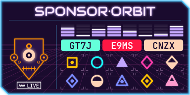
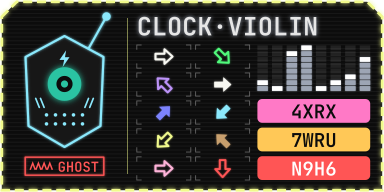

# visual256

Turn a 256-bit checksum into a small picture people can recognize and compare at a glance, and a
512-bit checksum into a numbered pair of them. Every bit is drawn, so two different checksums
always give two different pictures, and the exact checksum can be read back from the features.

The first style is the **Netrunner ID**: a 128 × 64 badge with an android head, a two-word
handle, a status chip, signal bars, 12 printed characters on colored chips and 10 detail cells.
The hash itself picks one of eight themes:

| | | | |
|---|---|---|---|
|  Cyberpunk |  Daylight |  Paper |  Blueprint |
|  Synthwave |  Terminal |  Arcade |  Stealth |

Each example above is a real SHA-256 badge (for `release-1.9.tar.gz`, `release-1.25.tar.gz`,
`release-1.11.tar.gz`, `release-1.2.tar.gz`, `release-1.20.tar.gz`, `release-1.0.tar.gz`,
`release-1.5.tar.gz` and `release-1.1.tar.gz`).

## Install

```bash
pip install "visual256[all] @ git+https://github.com/xTheBearx/visual256"
```

The core package needs only `fonttools`. The extras add output formats:

| Extra | Adds | Uses |
|---|---|---|
| `png` | PNG output | `resvg-py` |
| `pdf` | PDF output (no neon glow) | `cairosvg` |
| `all` | both | |

## Command line

```bash
visual256 release.tar.gz --format svg,png --width 256
```

```bash
visual256 --text "hello" --algo sha512 --format svg
```

```bash
visual256 --hex 5a725ab992a13c91274e2cc90248be7fe397a725a8a530ea09312bbd5d78e18e --format describe,words
```

Formats: `svg`, `png`, `pdf`, `datauri`, `html` (an `` tag), `words` (24-word spoken backup)
and `describe` (every feature in plain language). Files are written next to the input, or to the
path given with `-o` (without extension).

## Python

```python
from visual256 import Badge

badge = Badge.from_file("release.tar.gz")   # or from_text, from_hex, from_bytes
svg = badge.svg(width=256)                   # str
png = badge.png(width=512)                   # bytes, needs resvg-py
tag = badge.html_img(width=128)              #  with an embedded SVG
words = badge.mnemonic()                     # [[24 BIP-39 words]] per 256-bit part
for bits, label, value in badge.describe()[0]:
    print(bits, label, value)
```

`visual256.decode(32 bytes)` returns the badge's `Features`; `visual256.encode(features)` turns
them back into the same 32 bytes.

## How the 256 bits are used (spec v2)

Bits are read most significant first.

| Bits | Feature | Values |
|---|---|---|
| 0–2 | Theme | cyberpunk, daylight, paper, blueprint, synthwave, terminal, arcade, stealth |
| 3–5 | Card layout | 8 arrangements of face, handle, bars, chips and detail cells |
| 6–7 | Detail display | tiles, gems, hex pairs, arrows |
| 8–9 | Frame corners | which corners are cut |
| 10–11 | Frame style | single, double, dashed, corner brackets |
| 12–15 | Frame color | 16 theme colors |
| 16–19 | Visor color | 16 theme colors |
| 20–23 | Trim color | head outline, mods, mouth, cheek marks, decal |
| 24–27 | Accent color | signal bars and handle effects |
| 28–30 | Head shape | round, angular, boxy, dome, capsule, bucket, shield, skull |
| 31–33 | Visor style | band, twin-lens, slit, mono-eye, goggles, chevron, triple-lens, grid |
| 34–36 | Mouth | vents, teeth, dots, LED, zigzag, speaker, fangs, stitches |
| 37–38 | Head mod | antenna, ear discs, cable, fin |
| 39–42 | Forehead decal | 16 symbols |
| 43–44 | Cheek marks | stripes, dots, circuit, bolts |
| 45–48 | Status word | 16 words, e.g. GHOST, ROGUE, SYNCED |
| 49–52 | Status color | 16 theme colors |
| 53–54 | Rank | 1–4 chevrons on the status chip |
| 55–57 | Handle style | clean, horizontal split, vertical split, slice, inverted, underline, boxed, shadow |
| 58–68 | Handle word 1 | BIP-39 word |
| 69–79 | Handle word 2 | BIP-39 word |
| 80–103 | Signal bars | 8 bars, 1–8 lit segments each |
| 104–115 | Chip colors | 3 chips, 16 theme colors each |
| 116–175 | Characters | 12 characters, 4 per chip |
| 176–255 | Detail cells | 10 cells, one byte each (bytes 22–31 of the digest) |

The first 80 bits are headline features people remember. The other 176 bits are detail for a
careful side-by-side check. Detail elements are kept large on purpose: each detail cell carries a
whole byte through color, shape and fill instead of many tiny marks.

**Characters** use a 32-letter alphabet with no I, O, 0 or 1: `ABCDEFGHJKLMNPQRSTUVWXYZ23456789`.

**Detail displays** draw each byte as one of:

- **tiles**: a colored tile (high 4 bits) with a symbol (low 4 bits)
- **gems**: a colored shape; color (4 bits) × circle, square, triangle or diamond × solid, outline,
  dotted or half-filled
- **hex pairs**: two hex digits on a seven-segment display
- **arrows**: 8 directions × 16 colors × solid or outline

**Themes** are part of the hash. Each theme sets the background, the fonts and the 16 colors that
every color feature indexes into. New themes can be added later only with a new spec version,
because the theme field's width is fixed.

**512-bit checksums** (SHA-512) are split into two 256-bit parts and drawn as two badges in one
frame, numbered 1 and 2. Each part has its own theme; the frame takes its colors from part 1.

## Spoken backup

`badge.mnemonic()` and `--format words` give the standard BIP-39 encoding of each 256-bit part:
24 words, where the last word also carries an 8-bit checksum. It is useful for reading a checksum
over the phone. `visual256.bip39.from_mnemonic(words)` turns the words back into bytes and checks
the checksum; the first four letters of each word are enough.

## Browser preview

[`docs/netrunner-lab.html`](docs/netrunner-lab.html) is a self-contained page that draws the same
badges in the browser, with every layout, display and theme side by side, a one-bit-flip test and
a readout of every feature. Its drawing code mirrors `src/visual256/draw.py`; change both together.

## Development

```bash
pip install -e ".[dev]"
```

```bash
pytest
```

The tests check that every 32-byte input survives `encode(decode(x))`, that flipping any single
bit changes the features, the official BIP-39 test vectors, and that every theme × layout ×
display combination and every value of each face feature draws valid SVG.

## Third-party material

- `src/visual256/data/bip39_english.txt`: the BIP-39 English word list from
  [bitcoin/bips](https://github.com/bitcoin/bips/blob/master/bip-0039/english.txt), MIT license.
  Its SHA-256 is checked at load time.
- `src/visual256/fonts/`: subsets of Chakra Petch, JetBrains Mono, Spectral, Audiowide,
  Silkscreen and Saira Stencil One, under the SIL Open Font License 1.1 (license texts
  alongside). Text in every output is drawn as outlines, so no fonts need to be installed.
- `tests/data/bip39_vectors_256.json`: the 256-bit English entries from
  [trezor/python-mnemonic](https://github.com/trezor/python-mnemonic/blob/master/vectors.json),
  MIT license.
