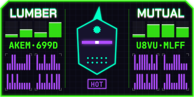
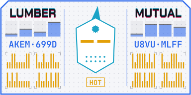
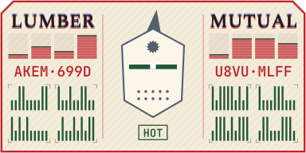
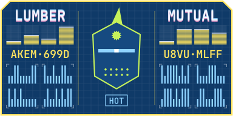

# visual256

Turn a 256-bit checksum into a small picture people can recognize and compare at a glance, and a
512-bit checksum into a numbered pair of them. Every bit is drawn, so two different checksums
always give two different pictures, and the exact checksum can be read back from the features.



The first style is the **Netrunner ID**: a 128 × 64 badge with an android head, a two-word
handle, a status word, signal bars, 16 printed characters and a detail block. Four themes are
included:

| Cyberpunk | Daylight | Paper | Blueprint |
|---|---|---|---|
|  |  |  |  |

A theme changes the look, never the bits. Badges can only be compared in the same theme, so pick
one theme per site or tool.

## Install

```bash
pip install "visual256[all] @ git+https://github.com/xTheBearx/visual256"
```

The core package needs only `fonttools`. The extras add output formats:

| Extra | Adds | Uses |
|---|---|---|
| `png` | PNG output | `resvg-py` |
| `pdf` | PDF output (no neon glow) | `cairosvg` |
| `all` | both | |

## Command line

```bash
visual256 release.tar.gz --format svg,png --width 256
```

```bash
visual256 --text "hello" --algo sha512 --theme paper --format svg
```

```bash
visual256 --hex 5a725ab992a13c91274e2cc90248be7fe397a725a8a530ea09312bbd5d78e18e --format describe,words
```

Formats: `svg`, `png`, `pdf`, `datauri`, `html` (an `` tag), `words` (24-word spoken backup)
and `describe` (every feature in plain language). Files are written next to the input, or to the
path given with `-o` (without extension).

## Python

```python
from visual256 import Badge

badge = Badge.from_file("release.tar.gz")          # or from_text, from_hex, from_bytes
svg = badge.svg(theme="cyberpunk", width=256)       # str
png = badge.png(theme="daylight", width=512)        # bytes, needs resvg-py
tag = badge.html_img(width=128)                     #  with an embedded SVG
words = badge.mnemonic()                            # [[24 BIP-39 words]] per 256-bit part
for bits, label, value in badge.describe("cyberpunk")[0]:
    print(bits, label, value)
```

`visual256.decode(32 bytes)` returns the badge's `Features`; `visual256.encode(features)` turns
them back into the same 32 bytes.

## How the 256 bits are used

Bits are read most significant first.

| Bits | Feature | Values |
|---|---|---|
| 0–2 | Card layout | 8 arrangements of face, handle, bars, characters and detail |
| 3–4 | Frame corners | which corners are cut |
| 5 | Frame line | single or double |
| 6–7 | Detail display | dots, shapes, barcode or hex segments |
| 8–11 | Frame color | 16 theme colors; also bars and characters |
| 12–15 | Visor color | 16 theme colors; also the detail block |
| 16–17 | Head shape | round, angular, boxy, dome |
| 18–21 | Trim color | head outline, mods, decal |
| 22–23 | Visor style | band, twin-lens, slit, mono-eye |
| 24–25 | Grille | vent, tooth, dot, LED |
| 26–27 | Head mod | antenna, ear discs, cable, fin |
| 28–31 | Forehead decal | 16 symbols |
| 32–35 | Status word | 16 words, e.g. GHOST, ROGUE, SYNCED |
| 36–39 | Status color | 16 theme colors |
| 40–41 | Handle glitch | clean, horizontal split, vertical split, slice |
| 42–52 | Handle word 1 | BIP-39 word |
| 53–63 | Handle word 2 | BIP-39 word |
| 64–95 | Signal bars | 8 bars, 1–16 lit segments each |
| 96–175 | Characters | 16 characters in 4 groups |
| 176–255 | Detail block | 4 groups of 20 bits, drawn in the detail display |

The first 64 bits are the headline features people remember. The other 192 bits are detail for a
careful side-by-side check.

**Characters** use a 32-letter alphabet with no I, O, 0 or 1: `ABCDEFGHJKLMNPQRSTUVWXYZ23456789`.
Each detail group is 20 bits, which is also exactly 4 characters, so `describe` can read any
detail group aloud.

**Detail displays** draw each 20-bit group as one of:

- **dots**: a 5 × 4 grid, lit or dark
- **shapes**: 5 shapes; each 4-bit value is a shape (circle, square, triangle, diamond) × a fill
  (solid, outline, dotted, half)
- **barcode**: 2 rows of 10 ticks, tall for 1 and short for 0
- **hex segments**: 5 hex digits on a seven-segment display

**512-bit checksums** (SHA-512) are split into two 256-bit parts and drawn as two badges in one
frame, numbered 1 and 2.

## Spoken backup

`badge.mnemonic()` and `--format words` give the standard BIP-39 encoding of each 256-bit part:
24 words, where the last word also carries an 8-bit checksum. It is useful for reading a checksum
over the phone. `visual256.bip39.from_mnemonic(words)` turns the words back into bytes and checks
the checksum; the first four letters of each word are enough.

## Browser preview

[`docs/netrunner-lab.html`](docs/netrunner-lab.html) is a self-contained page that draws the same
badges in the browser, with every layout, display and theme side by side, a one-bit-flip test and
a readout of every feature. Its drawing code mirrors `src/visual256/draw.py`; change both together.

## Development

```bash
pip install -e ".[dev]"
```

```bash
pytest
```

The tests check that every 32-byte input survives `encode(decode(x))`, that flipping any single
bit changes the features, the official BIP-39 test vectors, and that every layout, display and
theme draws valid SVG.

## Third-party material

- `src/visual256/data/bip39_english.txt`: the BIP-39 English word list from
  [bitcoin/bips](https://github.com/bitcoin/bips/blob/master/bip-0039/english.txt), MIT license.
  Its SHA-256 is checked at load time.
- `src/visual256/fonts/`: subsets of Chakra Petch, JetBrains Mono and Spectral, under the SIL
  Open Font License 1.1 (license texts alongside). Text in every output is drawn as outlines, so
  no fonts need to be installed.
- `tests/data/bip39_vectors_256.json`: the 256-bit English entries from
  [trezor/python-mnemonic](https://github.com/trezor/python-mnemonic/blob/master/vectors.json),
  MIT license.
