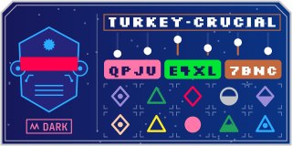
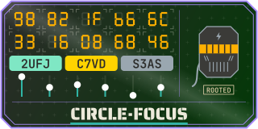
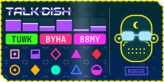
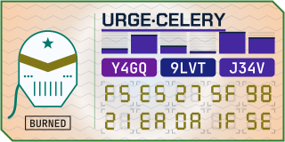
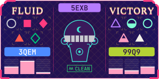
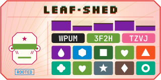
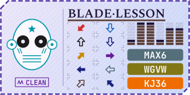
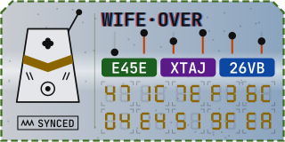

# visual256

Turn a 256-bit checksum into a small picture people can recognize and compare at a glance, and a
512-bit checksum into a numbered pair of them.

> **Development version 0.1.** The bit layout, themes and drawings may still change. Every
> change stays at 0.1 until the first release, so badges are not yet stable between commits.

The first style is the **Netrunner ID**: a 128 × 64 badge with a portrait (an android head, a
building or an animal), a two-word handle, a status chip, signal bars, 12 printed characters on
colored chips and 10 detail cells.
The badge bits pick one of sixteen themes, 8 dark and 8 light, each on a different background hue,
and a background gradient (theme color into one of 8 hues, or that hue from light to dark) in one
of four directions:

| | | | |
|---|---|---|---|
| <br>Cyberpunk · `release-1.2.tar.gz` | <br>Daylight · `release-1.3.tar.gz` | <br>Paper · `release-1.7.tar.gz` | <br>Blueprint · `release-1.0.tar.gz` |
| <br>Candy · `release-1.15.tar.gz` | <br>Mint · `release-1.4.tar.gz` | <br>Arcade · `release-1.14.tar.gz` | <br>Stealth · `release-1.25.tar.gz` |
| <br>Ember · `release-1.5.tar.gz` | <br>Abyss · `release-1.23.tar.gz` | <br>Sky · `release-1.6.tar.gz` | <br>Royal · `release-1.10.tar.gz` |
| <br>Citrus · `release-1.18.tar.gz` | <br>Jungle · `release-1.9.tar.gz` | <br>Lilac · `release-1.1.tar.gz` | <br>Concrete · `release-1.12.tar.gz` |

Each example is the real SHA-256 badge of the file name shown.

## Install

```bash
pip install "visual256[all] @ git+https://github.com/xTheBearx/visual256"
```

The core package needs only `fonttools`. The extras add output formats:

| Extra | Adds | Uses |
|---|---|---|
| `png` | PNG output | `resvg-py` |
| `pdf` | PDF output (no neon glow) | `cairosvg` |
| `all` | both | |

## Command line

```bash
visual256 release.tar.gz --format svg,png --width 256
```

```bash
visual256 --text "hello" --algo sha512 --format svg
```

```bash
visual256 --hex 5a725ab992a13c91274e2cc90248be7fe397a725a8a530ea09312bbd5d78e18e --format describe,words
```

Formats: `svg`, `png`, `pdf`, `datauri`, `html` (an `` tag), `words` (24-word spoken backup)
and `describe` (every feature in plain language). Files are written next to the input, or to the
path given with `-o` (without extension).

## Python

```python
from visual256 import Badge

badge = Badge.from_file("release.tar.gz")   # or from_text, from_hex, from_bytes
svg = badge.svg(width=256)                   # str
png = badge.png(width=512)                   # bytes, needs resvg-py
tag = badge.html_img(width=128)              #  with an embedded SVG
words = badge.mnemonic()                     # [[24 BIP-39 words]] per 256-bit part
for bits, label, value in badge.describe()[0]:
    print(bits, label, value)
```

`badge.parts` holds the mixed badge bits (`visual256.mix(checksum)`). `visual256.decode(bits)`
returns a badge's `Features`; `visual256.encode(features)` turns them back into the same 32 bytes.

## How a checksum becomes a badge

**1. Mixing.** The checksum is not drawn directly. Each badge shows
`SHA-256("visual256/netrunner/0.1" || part number || whole checksum)`. Flipping any single bit of
the checksum changes about half of the badge bits, so the new badge looks unrelated: usually a
different theme, layout, face and handle. Two different checksums give different badges unless
SHA-256 itself collides. The picture is a fingerprint and cannot be turned back into the
checksum; the spoken backup below encodes the checksum itself.

**2. Drawing.** The 256 badge bits are read most significant first.

| Bits | Feature | Values |
|---|---|---|
| 0–3 | Theme | 16 looks: background, pattern, fonts and the 16-color palette |
| 4–5 | Background gradient | left to right, top to bottom, diagonal or radial |
| 6 | Gradient tone | theme color into the hue, or the hue from light to dark |
| 7–9 | Gradient color | red, orange, yellow, green, cyan, blue, violet or magenta |
| 10–12 | Card layout | 8 arrangements of face, handle, bars, chips and detail |
| 13–14 | Detail display | tiles, gems, hex pairs or arrows |
| 15–16 | Frame corners | which corners of the frame are cut |
| 17–18 | Frame style | single, double, dashed or corner brackets |
| 19–20 | Bar style | segmented, solid, lollipops or chevrons |
| 21–24 | Frame color | frame and dividers |
| 25–28 | Visor color | visor, lit windows or eyes |
| 29–32 | Trim color | outlines, roofs, doors, mouths, marks and decal |
| 33–36 | Accent color | signal bars and handle effects |
| 37–41 | Subject | 8 android heads, 12 buildings or 12 animals |
| 42–44 | Visor / windows / eyes | 8 styles for the subject's kind |
| 45–47 | Mouth / door / nose | 8 styles for the subject's kind |
| 48–49 | Head mod / roof / accessory | 4 styles for the subject's kind |
| 50–53 | Decal / sign / mark | one of 16 symbols |
| 54–55 | Cheeks / grounds / markings | 4 styles for the subject's kind |
| 56–59 | Status word | one of 16 words |
| 60–63 | Status color | status chip |
| 64–66 | Handle style | clean, split, vertical split, slice, inverted, underline, boxed or shadow |
| 67–77 | Handle word 1 | BIP-39 word, 1 of 2048 |
| 78–88 | Handle word 2 | BIP-39 word, 1 of 2048 |
| 89–103 | Signal bars | 5 bars, 1–8 levels each |
| 104–115 | Chip colors | 3 chips, 16 theme colors each |
| 116–175 | Characters | 12 characters, 4 per chip |
| 176–255 | Detail cells | 10 cells, one badge byte each |

The first 89 bits are headline features people remember. The other 167 bits are detail for a
careful side-by-side check. Detail elements are kept large on purpose: each detail cell carries a
whole byte through color, shape and fill instead of many tiny marks. Every badge bit is drawn:
`encode(decode(bits)) == bits`.

**Characters** use a 32-letter alphabet with no I, O, 0 or 1: `ABCDEFGHJKLMNPQRSTUVWXYZ23456789`.

**Detail displays** draw each byte as one of:

- **tiles**: a colored tile (high 4 bits) with a symbol (low 4 bits)
- **gems**: a colored shape; color (4 bits) × circle, square, triangle or diamond × solid, outline,
  dotted or half-filled
- **hex pairs**: two hex digits on a seven-segment display
- **arrows**: 8 directions × 16 colors × solid or outline

**Subjects.** Bits 37–41 pick the portrait: 8 android heads (round, angular, boxy, dome,
capsule, bucket, shield, skull), 12 buildings (house, tower, skyscraper, castle, pagoda,
observatory, lighthouse, factory, chapel, temple, windmill, needle tower) or 12 animals (cat, dog,
bear, rabbit, fox, owl, mouse, pig, frog, penguin, lion, panda). The next fields mean different
things for each kind:

| Field | Android head | Building | Animal |
|---|---|---|---|
| Visor / windows / eyes | 8 visors | 8 window patterns | 8 eye styles |
| Mouth / door / nose | 8 mouths | 8 doors | 8 noses and mouths |
| Head mod / roof / accessory | antenna, ear discs, cable, fin | antenna, flag, chimney, satellite dish | collar, bow, party hat, scarf |
| Decal / sign / mark | forehead decal | sign plaque | forehead mark |
| Cheeks / grounds / markings | stripes, dots, circuit, bolts | steps, fence, bushes, lamp posts | whiskers, spots, blush, stripes |

**Themes** set the background, its pattern, the fonts and the 16 colors that every color feature
indexes into. The badge bits then pick one of 8 hues (red, orange, yellow, green, cyan, blue,
violet or magenta) and a tone: either the theme color fading into the hue, or the hue itself from
light to dark. The gradient runs left to right, top to bottom, diagonally or radially, with a
highlight streak along the same direction (a ring for radial gradients). That gives 64
backgrounds per theme. `tools/tune_gradients.py` picks each theme's streak strength, its 8
gradient colors and its 8 light-to-dark tone pairs as strong as the palette allows: every palette color keeps at least 2:1 contrast
against the background and every gradient color, and 1.8:1 inside the narrow streak band
(checked by the tests).

**512-bit checksums** (SHA-512) are drawn as two badges in one frame, numbered 1 and 2. Both
badges depend on the whole checksum. The frame takes its colors from badge 1's theme.

## Spoken backup

`badge.mnemonic()` and `--format words` give the standard BIP-39 encoding of the checksum itself,
per 256-bit part:
24 words, where the last word also carries an 8-bit checksum. It is useful for reading a checksum
over the phone. `visual256.bip39.from_mnemonic(words)` turns the words back into bytes and checks
the checksum; the first four letters of each word are enough.

## Browser preview

[`docs/netrunner-lab.html`](docs/netrunner-lab.html) is a self-contained page that draws the same
badges in the browser, with every layout, display and theme side by side, a one-bit-flip test and
a readout of every feature. It is built from `docs/lab-template.html` by `python docs/build_lab.py`,
which injects the theme collection and word list from the package. Its drawing code mirrors
`src/visual256/draw.py`; change both together.

## Development

```bash
pip install -e ".[dev]"
```

```bash
pytest
```

The tests check that every badge value survives `encode(decode(x))`, that flipping any single
checksum bit changes more than a quarter of the bits of every badge, the official BIP-39 test
vectors, palette contrast in every theme, and that every theme × layout × display combination and
every value of each face feature draws valid SVG.

## License

MIT, see [LICENSE](LICENSE). Bundled third-party material keeps its own license:

## Third-party material

- `src/visual256/data/bip39_english.txt`: the BIP-39 English word list from
  [bitcoin/bips](https://github.com/bitcoin/bips/blob/master/bip-0039/english.txt), MIT license.
  Its SHA-256 is checked at load time.
- `src/visual256/fonts/`: subsets of Chakra Petch, JetBrains Mono, Spectral, Audiowide,
  Silkscreen and Saira Stencil One, under the SIL Open Font License 1.1 (license texts
  alongside). Text in every output is drawn as outlines, so no fonts need to be installed.
- `tests/data/bip39_vectors_256.json`: the 256-bit English entries from
  [trezor/python-mnemonic](https://github.com/trezor/python-mnemonic/blob/master/vectors.json),
  MIT license.
